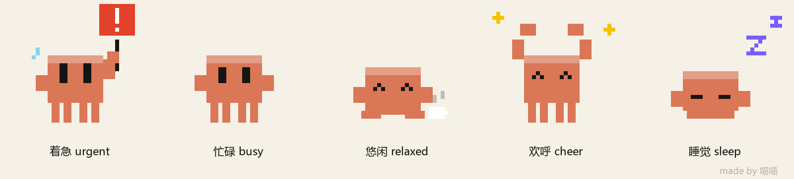
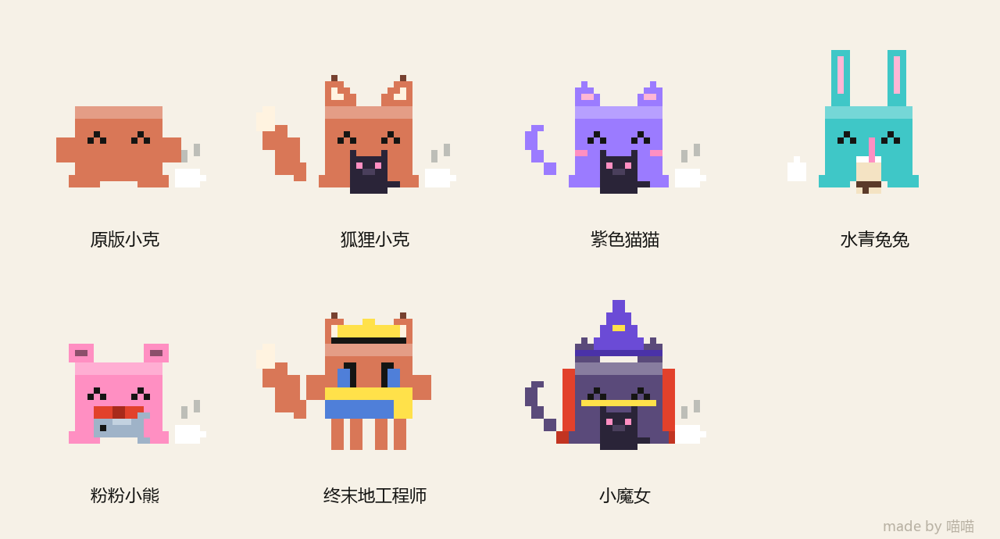
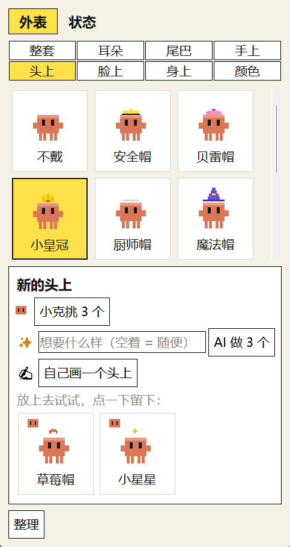
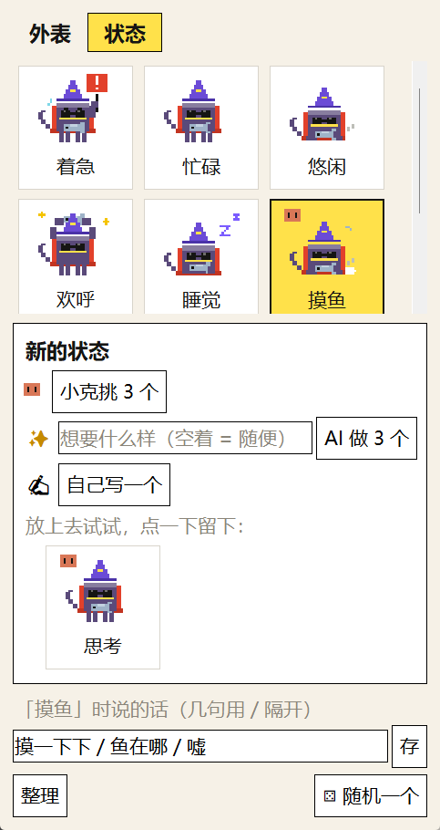

# ClawdPet

[简体中文](README.zh-CN.md) · **English** · [繁體中文](README.zh-TW.md) · [日本語](README.ja.md) · [한국어](README.ko.md)

Interface languages: 简体中文 · 繁體中文 · English · 日本語 · 한국어 (follows your Windows language; switch any time from the right-click menu).

A pixel Clawd that lives on your desktop. While your AI assistant is working, Clawd gets busy too; when the AI finishes, Clawd throws its arms up and cheers; when the AI is waiting for your reply, Clawd holds up a sign and starts to fret.

It shows what your AI assistant is doing at a glance — busy, done, or waiting for you — and any AI assistant can change it with one command.



Made by **Miaomiao** (GitHub [@Miaomiaomeowmeow](https://github.com/Miaomiaomeowmeow)) · License [CC BY-NC-SA 4.0](LICENSE): you can change it, but no commercial use · Windows only

> **The author is looking for a job!** If you have an opportunity, contact me on [LinkedIn](https://www.linkedin.com/in/miaomiao-yang-331901383) · Xiaohongshu (RED) @羊猫猫不是猫 · [More ways to reach me](#contact-the-author)

---

## Install

You need Python 3 first ([download from python.org](https://www.python.org/downloads/); during setup, tick "Add python.exe to PATH").

1. Download this repository (top right: Code → Download ZIP) and unzip it into a folder you won't move around
2. Double-click `start.bat`, and Clawd appears in the bottom-right corner of your screen

**Don't want to do it yourself?** Give `AI-SETUP.md` to your AI (Codex, Claude Code, Cursor… any of them) and say "Follow AI-SETUP.md and install ClawdPet for me." It will ask you a few questions one at a time, make a desktop shortcut for you, and set up the automatic state changes.

## Let your AI tell Clawd what it's doing

Any AI assistant can use this one command (run it inside your project folder; the project name is taken from the folder name automatically):

```
python "<where-the-pet-is-installed>/pet.py" busy "Writing the login page"
```

| State | When to use it | What Clawd looks like |
|---|---|---|
| `urgent` Rushing | It needs you to reply / decide / approve something | Holds up a red sign, sweating |
| `busy` Busy | It's working | Stands and sways |
| `relaxed` Chill | Nothing going on | Lies down sipping tea |
| `cheer` Cheering | It finished a chunk of work | Arms up, sparkling stars |
| `sleep` Sleeping | — | Falls asleep by itself from 1 am to 7 am |

- Want your AI to remember every time? Paste the snippet from `AI-RULES.md` into its instructions file (`AGENTS.md`, `CLAUDE.md`…)
- Want it fully automatic (you send a message → Busy, AI finishes → Cheering, AI waits for you → Rushing)? Claude Code and Codex can be hooked up; see [`hooks/`](hooks/README.md)
- Right-click Clawd → "Recently doing": see what the AI has recently told Clawd, for which project, and at what time
- States expire on their own: if nobody updates them, Cheering turns back to Chill after 15 minutes, and Busy / Rushing after 3 hours

## Playing with Clawd

- **Click**: opens the Claude desktop app by default. Right-click → "Click to open" lets you change it to: Clawdfield (only shows up once it's connected) / Open nothing (Clawd hops and says something) / any program or web address you choose (for example Codex or another AI app)
- **Drag**: move it anywhere; it remembers where you put it
- **Right-click**: State, Look (wardrobe), Size, Recently doing, Click to open, Connections, Show at startup, About

## New outfits, new states: Clawd's wardrobe

Right-click → "Look" → "Open wardrobe", and the wardrobe opens right next to Clawd, with four pages: **Character** (who it is), **Looks** (what it wears), **State** (what it's doing) and **Personality** (what it's like). Looks has 7 built-in full sets, plus build (slim, chubby, tall, mini…), ears, tail, hands, head, face, body and color, which you can swap piece by piece:



- **Hover over a tile**: Clawd on your desktop tries it on right away and changes back when you move away; it only really puts it on when you click
- **The last tile, "＋ New"**, gives you three ways:
  - Clawd picks 3: Clawd chooses by its own taste; hover over one and it tells you why it likes it
  - ✨ AI makes 3: write one line about what you want (leave it empty and it makes whatever it likes)
  - ✍ Draw your own: a pixel canvas — left-click to draw, right-click to erase; pick your own colors; drag two sliders (width, height) for the build; save a full set with "Save this outfit as a set"
- The difference between **Clawd picks** and **AI makes**: Clawd picks = chosen to fit its own personality (you don't need to ask for anything); AI makes = made to the request you write
- Both borrow the Codex or Claude Code that's already signed in on your computer (no key needed). Drawing takes a little while, usually from ten-odd seconds to a minute or two; while you wait, it shows how many seconds have passed, and if you don't want to wait, click "Stop waiting". If you have neither installed, it copies a sentence for you to paste to your own AI instead
- **Tidy up**: built-in items get hidden (you can bring them back); things you or the AI made are deleted for real
- Small badges on tile corners: ✎ made by you · ✨ made by AI · Clawd's face = picked by Clawd

<table><tr><td></td><td></td></tr></table>

**You can add your own states too**: use the wardrobe's "State" page, or right-click → "State" → "＋ Add a state". A state = a name + which pose to use (Rushing / Busy / Chill / Cheering / Sleeping) + a few lines Clawd says in that state + changes to how Clawd looks on the canvas (optional): add a little prop, paint over the eyes with "Clawd color" and draw a new expression, right-click to erase a few pixels to change the pose, or even "Erase all" and draw a new one from scratch. You can also change what the 5 built-in states say. Right-click → "State" → "⚄ Random one" switches to a random one.

**Random outfit**: right-click → "Look" → "⚄ Random outfit" picks a full set from the wardrobe (the 7 built-in ones + the ones you saved) that's different from what Clawd is wearing now; "Auto random outfit" changes it by itself every 30 minutes / 1 hour / 3 hours / day. It only changes clothes, not the state (random states are under "State").

If you're connected to Clawdfield, you get two more: in the Clawdfield wardrobe click "Copy to pet", then come here and right-click → "Look" → "Paste look from Clawdfield" (clothes you drew and sets you saved all come over); right-click → "Look" → "Randomly become a Clawdfield Clawd" switches to one of the other Clawds in your Clawdfield (each with its own look); while this is on, it takes priority.

## Language

Right-click → "Language": 简体中文 / 繁體中文 / English / 日本語 / 한국어. By default it follows your Windows display language. After switching, Clawd restarts briefly. Want to add a language? Add a translation to every entry in `lang.json`, then add one line to `LANGS` in `lang.py`.

## Personality

Even when you use the pet on its own, Clawd has a personality: the first time you open it, it gets a random one (Little Sunshine, Tsundere, Slowpoke, Chuuni Hero, Neat Freak, Shy Bean, Foodie, Tiny Philosopher). You can change it on the wardrobe's "Personality" page:

- **⚄ Random one**, or click one of the built-in ones; hover over one and Clawd tells you what it's like
- **Write your own**: a name + a one-line description, then click "Save"
- **✨ Let AI write one to your request**: the result goes into the boxes first, and it only switches over after you've looked at it and clicked "Save"
- **Let Clawd write lines by personality**: Clawd rewrites what it says in the 5 states (plus any states you added) and when it's clicked, to fit this personality; you see the lines first, and only the ones you check get swapped in
- "Clawd picks 3" also picks according to this personality

## When connected to Clawdfield

Clawd's character, clothes and personality all follow Clawdfield, so they can't be changed in the wardrobe here — that way both sides stay the same. To change the look: in Clawdfield, right-click Clawd → "Look" → "Copy to pet", then come back here and right-click → "Look" → "Paste look from Clawdfield". Want a Clawd just for the desktop pet? Create a new "Desktop Pet Clawd" in Clawdfield, dress it up, then copy it over. Don't want to stay connected? Right-click → "Connections" → turn Clawdfield off, and the wardrobe comes back.

## Change character: it doesn't have to be Clawd

Clawd is the default, but the pet can be any character: a cat, a blob of slime, or what your own AI assistant looks like. Right-click → "Look" → "Change character…", or use the wardrobe's "Character" page:

- **What counts as what**: if it's still Clawd once all the clothes come off (Fox Clawd, Purple Kitty, Aqua Bunny…), it's a "Full set" and lives on the "Looks" page; only something with a different body outline counts as a "Character"
- **"＋ New"**: ✍ draw one yourself (the dashed box is about Clawd's size, and its feet stand on the bottom of the box; the color you use most becomes its main color) / ✨ AI draws 3 / Clawd picks 3 for you
- **The 5 poses are set up automatically**: Rushing with a sign, Busy, Chill with tea, Cheering with stars, Sleeping with Zs. Don't like one? Click the row of small pictures at the bottom of the Character page and fix it yourself on the canvas (for example, close its eyes for Sleeping); if you mess it up, click "Back to auto"
- **Clothes still work**: hats, ears and things it holds are fitted to its size; "Color" changes its main color; you can adjust the build too
- Changes to the look that you made in your own states only apply to the character you drew them on, so switching characters won't mix them up
- You can change what a click opens too (right-click → "Click to open" → choose another program), for example Codex or the AI app you use most
- Want to change it all at the code level? Clawd is drawn by `clawd()` in `clawd_pet.py`, and other characters by `char_cells()`; when you're done, remember to note what you changed, as the license requires

## Connecting with other Clawd apps

ClawdPet, the "Clawdfield" workbench and the "Clawkie" walkie-talkie chat window each work on their own. Whichever ones you install, Clawd finds them by itself (through the "name cards" in `.clawd\` in your user folder) and connects automatically the first time it spots them, with no setup; **the related menu items only show up once they're connected**:

| What you have installed | What Clawd does |
|---|---|
| Just the pet | State, wardrobe and "Recently doing" all work; a click opens the Claude app (or whatever you chose) |
| + Clawdfield | The right-click menu gains "Open Clawdfield", "Paste look from Clawdfield" and "Randomly become a Clawdfield Clawd"; "Click to open" can be set to Clawdfield (if it isn't running, Clawd starts it for you) |
| + Clawkie | Clawd holds a tiny walkie-talkie: click the walkie-talkie or double-click Clawd = bring up Clawkie, press and hold = push to talk |
| All three | Click Clawd = whatever you chose (Claude / Clawdfield), click the walkie-talkie = Clawkie |

Right-click → "Connections" lets you turn them on and off by hand: if Clawdfield can't be found, turning it on asks you where it's installed; once you turn one off, it won't connect automatically again.

Clawdfield and Clawkie are the author's other projects and will be published on [the author's GitHub](https://github.com/Miaomiaomeowmeow); if you don't see them yet, they'll be up in a while.

## Files

| File | What it is |
|---|---|
| `clawd_pet.py` | Clawd itself (uses only what comes with Python; nothing else to install) |
| `pet.py` | A small command that changes Clawd's state (it can also add states, clothes, colors and full sets) |
| `wardrobe.py` | The wardrobe window |
| `lang.py` / `lang.json` | Multiple languages (the interface text and its translations) |
| `start.bat` | Double-click to start |
| `AI-SETUP.md` / `AI-RULES.md` | For your AI to read: the setup guide / the snippet to paste into its instructions file |
| `hooks/` | How to make it change automatically along with your chats |
| `status.json` / `settings.json` / `recent.json` | Created while it runs: current state / your settings / the latest few messages |

Clawd leaves a "name card" (`.clawd\pet.json`) in your user folder that says where it's installed; that's how Clawdfield finds Clawd.

## Contact the author

**I'm looking for a job!** If you have a suitable opportunity, I'd love to hear from you:

- LinkedIn: [Miaomiao Yang](https://www.linkedin.com/in/miaomiao-yang-331901383) (new projects get posted here too — follow along!)
- Xiaohongshu (RED): @羊猫猫不是猫
- GitHub: [Miaomiaomeowmeow](https://github.com/Miaomiaomeowmeow) (the author's other projects)
- Personal website (résumé + more fun projects): still in progress, it'll go here once it's done; follow on LinkedIn for now

You can also find this inside the pet: right-click Clawd → "Contact the author · Job hunting!"

## License

[CC BY-NC-SA 4.0](LICENSE): free to use and free to change; credit the original author, Miaomiao; **no commercial use**; if you publish a changed version, use the same license and say what you changed. If you only change it privately for yourself, you don't need to share it.
I'd really love to hear what you changed — I can learn from it, and I can help spread the word about your version too.

